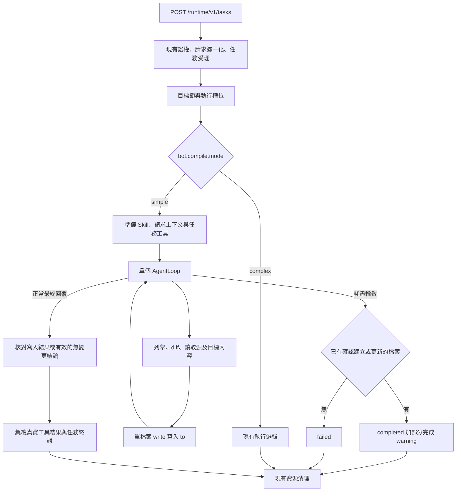

# VikingBot Compile simple 模式實施計劃

## 1. 目標與完成標準

文件狀態為待評審。目標讀者為 VikingBot、Compile 和商業版 Runtime 的維護者。交付目標是在 VikingBot 內增加預設的 simple 執行模式，使用一個 AgentLoop，根據 Skill 和 instruction 讀取輸入，並透過 OV 單檔案 write 逐次寫入目標目錄。

| 專案 | 約定 |
|---|---|
| 配置入口 | `bot.compile.mode`，取值為 `simple`、`complex`，預設 `simple` |
| simple | 一個 AgentLoop，任務提示詞、OV 讀取工具、單檔案寫工具和普通最終回覆 |
| complex | 顯式配置後執行現有分支，包括 direct、planner/pipeline 和現有 memory 路徑 |
| 全量與增量 | 使用請求中的 `args.changes.execution.mode`，相容已有 `last_compile_time` 輸入 |
| 輪次耗盡 | 至少一個目標檔案已確認建立或更新時，返回 `completed` 並在 `result.warnings` 標明部分完成。零產出時返回 `failed` |
| 修改範圍 | 實現、測試、說明文件均位於 `bot/` |

驗收要求包括預設值生效、complex 迴歸透過、全量與增量可完成真實編譯、逐次寫入可觀測、失敗與取消狀態準確，以及公共核心和商業版介面契約迴歸透過。

## 2. 已確認事實與證據

以下依據為當前本地原始碼。線上部署版本與實際 Runtime 地址屬於獨立驗證項。

| 已確認事實 | 證據路徑 | 結論與建議範圍 |
|---|---|---|
| Runtime 建立介面將請求交給 `BotCompileService.create_task` | [compile/router.py](../../../vikingbot/compile/router.py) | mode 分流放在 service，繼續使用現有建立、狀態和取消入口 |
| `CompileConfig` 已集中儲存 Map、Shuffle、Reduce 引數 | [config/schema.py](../../../vikingbot/config/schema.py) | 在該模型增加 mode 預設值與列舉校驗 |
| service 已負責身份、冪等、目標鎖、任務狀態、沙箱和模型併發 | [compile/service.py](../../../vikingbot/compile/service.py) | simple 複用該生命週期 |
| 底層 `_run_agent_loop` 支援獨立提示詞、工具集和終止工具 | [agent/loop/loop.py](../../../vikingbot/agent/loop/loop.py) | simple 可直接呼叫現有迴圈 |
| `run_structured_task` 的提交檢查繫結 `submit_wiki_bundle` | [agent/loop/loop_tools.py](../../../vikingbot/agent/loop/loop_tools.py) | simple 使用底層 loop，按最終回覆或預算耗盡的退出分支判定結果 |
| Bot 的 `write_file` 寫入任務工作區 | [agent/tools/filesystem.py](../../../vikingbot/agent/tools/filesystem.py) | simple 需要把 SDK 的 OV write 暴露為任務工具 |
| OV SDK 已提供單檔案 `write(uri, content, mode)` | [SDK client.py](../../../../sdk/python/openviking_sdk/client.py) | Bot 增加薄適配，繼續呼叫已有 HTTP 單檔案介面 |
| OV diff 工具已有分頁；list 的模型引數沒有 offset | [agent/tools/ov_file.py](../../../vikingbot/agent/tools/ov_file.py) | 複用 diff；補充目錄分頁並保留已有呼叫的預設行為 |
| 當前 Skill 目標透過整包校驗及 `add_skill` / `update_skill` 釋出 | [compile/service.py](../../../vikingbot/compile/service.py) | Skill 產物的支援範圍列為評審項，避免把普通寫入等同於完整安裝 |
| 核心管理開始/結束快照與失敗回滾 | [compile_targets.py](../../../../openviking/service/compile_targets.py) | simple 提供真實 Runtime 狀態，由核心完成收尾 |

核心在成功收尾時將本次輸入快照儲存為 `source_commit`，將請求的全部 `from` 儲存為 `processed_roots`。下次增量按源快照間的變化選取輸入。Runtime 的 warnings 不參與這兩個判斷。現有 complex 已有將部分產出作為 completed 並附 warnings 的路徑。詳見 [核心增量計劃與基線](../../../../openviking/service/compile_targets.py) 和 [Bot 完成分支](../../../vikingbot/compile/service.py)。

### 2.1 待確認的邊界

| 邊界 | 當前證據與影響 | 建議 |
|---|---|---|
| `to` 指向 Skill 包 | 現有釋出帶有整包校驗與安裝語義；單檔案 write 是否滿足目標名稱空間及索引要求需要專項核對 | simple 首版支援資源和 memory 目標；Skill 產物使用顯式 complex。該支援範圍變化需要評審確認 |
| 受管目標的版本記錄 | 普通 write 預設採用 manual 來源，有版本服務時會走普通編輯記錄路徑 | 整合驗收核對實際操作記錄、成功快照及失敗回滾；單檔案回執確認正文寫入，索引重新整理非同步完成 |
| 外部併發編輯 | 單檔案 write 請求沒有 `expected_sha256` 欄位 | 沿用介面的覆蓋語義和 Bot 目標鎖，明確該鎖只協調當前服務內的 Compile；額外的跨客戶端併發編輯仍存在覆蓋風險 |

## 3. 配置與相容行為

推薦配置示例採用以下結構。

```json
{
  "bot": {
    "compile": {
      "mode": "simple",
      "map_concurrency": 30,
      "shuffle_concurrency": 20,
      "reduce_concurrency": 30
    }
  }
}
```

| 輸入 | 預期行為 |
|---|---|
| 省略 compile 或省略 mode | simple |
| `mode="simple"` | simple，Map/Shuffle/Reduce 的並行引數僅在 complex 執行時使用 |
| `mode="complex"` | 當前 complex 執行行為 |
| mode 為其他值或 null | 配置校驗報錯 |
| 舊配置只包含併發引數 | 升級後使用 simple；需要現有執行行為的部署應顯式配置 complex |

`bot.compile.mode` 選擇執行器，`args.changes.execution.mode` 選擇本次全量或增量的輸入範圍。任務受理時將生效的執行器模式寫入現有 `task.meta`，便於檢視實際行為。相同冪等鍵繼續返回已經存在的任務。

## 4. 執行流程



simple 分支儘早進入自身輸入準備邏輯，避免全量場景先由 service 列舉完整檔案清單。Skill 主檔案由 runtime 讀取並放入提示詞，附件由 Agent 按需讀取。請求中的 Skill snapshot 繼續經現有 connection 傳遞。

### 4.1 全量提示詞

提示詞必須包含以下資訊，並使用結構化序列化傳入使用者欄位。

| 資訊 | 行為要求 |
|---|---|
| 編譯型別 | 明確這是一次全量編譯，全量覆蓋本次 from 的輸入 |
| from、to | from 為讀取範圍，to 為輸出根目錄；允許按目錄逐頁列舉並邊讀邊寫 |
| Skill 與 instruction | Skill 正文、Skill 根 URI 與使用者指令共同定義產物；附件引用按需讀取 |
| 已有目標 | 更新前讀取相關內容，保留與本次任務無關的有效內容 |
| 完成條件 | 處理完所需輸入、確認所有必要寫入後直接回復結果；有未解決錯誤時說明失敗 |

完整掃描輸入不自動意味著清空目標目錄。具體產物組織和更新策略由 Skill 與 instruction 定義。

### 4.2 增量提示詞

在全量提示詞的通用資訊之外，補充 `base`、`head`、`full_dirs`、`diff_dirs` 及 `execution.mode`。

| 輸入 | Agent 行為 |
|---|---|
| full_dirs | 完整讀取這些新增或要求全量處理的目錄 |
| diff_dirs | 使用固定 base/head 呼叫 diff，翻頁直到結束 |
| added / modified | 讀取必要源內容，並讀取受影響的已有目標，更新相關產物 |
| deleted | 根據目標中的引用和內容判斷影響，透過重寫檔案清除失效內容；需要物理刪除整個目標檔案時，報告工具能力不足 |
| 變更集合為空 | 可以明確以無變更完成 |

diff 比較的是傳入的快照，普通讀取沿用當前 OV read 的語義。原始檔在執行期間發生變化時，不能承諾讀取內容嚴格對應 head。

### 4.3 相容已有呼叫

優先採用 `changes.execution.mode`。缺少 changes 時，保留當前 instruction 與 `last_compile_time` 的優先關係。有截止時間的舊請求複用現有檔案篩選邏輯，把選中的檔案交給 simple；其他請求按全量處理。沒有候選源的舊增量請求沿用提前完成行為。

## 5. 任務工具與單檔案寫入

### 5.1 工具集合

| 工具 | 來源與職責 |
|---|---|
| openviking_list | 複用現有工具，補充 offset、limit 引數供逐頁遍歷 |
| openviking_multi_read | 讀取 from、to 與 Skill 附件，保留範圍讀取能力 |
| openviking_grep / openviking_glob | 查詢相關原始檔、已有目標和引用 |
| openviking_diff_paths | 增量時註冊，繫結本次 diff_dirs 與 base/head，避免模型自行選擇比較版本 |
| openviking_write | 使用當前請求身份寫入 to 下的單個檔案 |

單個 loop 透過上述工具完成任務。必要的上下文壓縮和模型呼叫限額複用現有實現。Skill 如果要求當前工具集之外的能力，任務返回具體缺失能力，避免把缺失產物記成成功。

### 5.2 openviking_write

工具引數為目標相對路徑、文字內容和 `mode`，mode 支援 `replace`、`append`，預設 `replace`。底層每次呼叫一次 SDK `write(uri, content, mode=mode)`，使用請求認證身份，省略 `options`。

寫入路徑透過現有相對路徑驗證與 URI 拼接函式構造，限定在當前 to 下。拒絕絕對 URI、路徑穿越和受保護的派生檔案。服務端繼續執行 ACL 與名稱空間校驗。

沿用 SDK 預設的 `wait=False`。正文提交後繼續下一步，索引等後續處理可非同步完成。複用 Bot 已有目標鎖與服務端單檔案寫鎖。有先後依賴的寫操作分輪呼叫。append 遇到響應不確定時需要讀取核實，避免自動重試產生重複內容。

### 5.3 結果與失敗記錄

沿用 `CompileResult` 和現有 task.meta 容器。真實寫入列表來自工具記錄。服務端未提供 created/updated 分類時，在首寫前檢查檔案是否存在，據此彙總 created 或 updated；該分類存在外部併發寫入時的競爭視窗。

成功寫入路徑按 URI 去重，任務內新建後再次修改仍計入 created。對確認內容相同的替換操作可記錄 unchanged。page_count 使用去重後的成功目標檔案數；link_count 的精確統計能力為待確認，預設值不能作為已檢查連結的證明。

每次寫入回執後持久化必要的輸出進度到 task.meta。失敗、取消時仍可看到已確認寫入的路徑以及回執不確定的寫入，任務終態由現有生命週期管理。記錄只包含必要 URI、狀態及脫敏錯誤資訊。

### 5.4 最終回覆與輪次耗盡

simple 複用普通 AgentLoop 的最終回覆分支。在 Bot 內給該迴圈增加僅 simple 啟用的嚴格結束判斷，沿用現有返回結構和其他呼叫方的預設行為。模型正常結束、返回非空正文且本輪沒有工具呼叫時退出；寫入結果或有效的無變更結論透過檢查後記為 completed。最後一輪也適用。

當迴圈自然耗盡預算時，在生成聊天兜底文字前向 simple 執行器報告耗盡。執行器依據工具回執決定終態，最後一輪本身可以產生有效產出。

| 退出原因 | Runtime 狀態與結果 |
|---|---|
| 自然結束，任務完成或確認無需變更 | `completed`。正常的增量無變更可以是零寫入 |
| 僅因輪次耗盡結束，已有確認建立或更新的目標檔案 | `completed`。返回已確認的目標 URI，將部分完成說明放入 `result.warnings` |
| 輪次耗盡，只有讀取、未變化檔案、失敗寫入或回執不確定 | `failed`。說明耗盡且沒有確認產出 |
| 模型錯誤、截斷、未解決的執行錯誤 | `failed`。保留具體錯誤和已確認寫入記錄 |
| 使用者取消 | `cancelled`。取消優先於部分完成 |

部分完成 warning 使用去重後的目標檔案數，例如“已達到最大輪數，部分編譯完成，已寫入 80 個目標檔案。後續增量可能跳過本次未處理且未變化的源。需要重新覆蓋全部輸入時，請發起全量編譯。”輸出檔案數只表示已交付的檔案數量，輸入覆蓋率未知。

對於經 `/api/v1/compile` 發起的任務，部分完成會按成功提交到 `to`。核心會推進該觸發方式的增量基線。相同 Skill 和 instruction 下，源沒有新變化時，下一次增量可能在核心直接完成。顯式 `args.mode="full"` 可重新掃描全部輸入；相同預算仍可能再次耗盡。斷點續編和逐檔案補齊沒有現成的核心進度語義。

### 5.5 取消與可見性

任務寫入期間保持 running，取消介面可中斷 loop。取消確認之後，工具入口阻止新的寫入。已發出的 HTTP 寫請求可能已經到達服務端，客戶端取消無法保證撤銷該請求。

邊讀邊寫使中間產物可見。核心收到 failed 或 cancelled 時，在當前任務已有起始快照且尚未提交結束快照的條件下，嘗試恢復 to 的起始版本。直接呼叫 Bot Runtime 的任務可能保留部分輸出，status 中應提供已確認寫入進度；Bot 對整次任務原子回滾的能力不作承諾。

## 6. 修改檔案與預期產出

| 檔案 | 型別 | 修改內容 | 預期產出 |
|---|---|---|---|
| `bot/vikingbot/config/schema.py` | 修改 | mode 列舉與預設值，更新 CompileConfig 註釋 | 配置可校驗，舊配置預設 simple |
| `bot/vikingbot/compile/service.py` | 修改 | 選擇執行器、接入 simple、傳遞上下文、持久化 mode 與結果進度 | 現有任務生命週期覆蓋兩種模式 |
| `bot/vikingbot/agent/loop/loop.py` | 修改 | 為 simple 提供按實際退出分支判斷異常與耗盡的可選行為 | 保留普通聊天現有的兜底回覆 |
| `bot/vikingbot/compile/simple.py` | 新增 | 提示詞、任務工具、單個 loop、結束校驗和輸出記錄 | 自包含的 simple 執行實現 |
| `bot/vikingbot/openviking_mount/ov_server.py` | 修改 | 單檔案 write 薄適配，複用 SDK 和請求身份 | simple 可呼叫已有 OV 單檔案介面 |
| `bot/vikingbot/agent/tools/ov_file.py` | 修改 | 為 list 增加模型可用的分頁引數，保持原有預設呼叫行為 | 大目錄可以完整列舉 |
| `bot/tests/test_compile_simple.py` | 新增 | 配置、分流、提示詞、工具與任務狀態用例 | simple 行為及關鍵失敗路徑自動驗證 |
| `bot/tests/test_openapi_auth.py` | 按需修改 | 新預設值適配及 Runtime 契約斷言 | 建立、狀態、取消與身份隔離迴歸 |
| `bot/README.md`、`bot/README_CN.md` | 修改 | 預設模式、顯式 complex 示例、部分完成 warning、增量遺漏與全量重掃 | 開源使用者可直接配置和判斷結果 |

simple 專用工具先集中在 `simple.py`，隨檔案實際規模再評估是否需要拆分。新增關鍵實體、方法及有業務語義的欄位遵循倉庫註釋規範。

允許的實現修改路徑為 `bot/`。評審 diff 應驗證公共核心、SDK、商業版 Go 服務及部署配置的檔案集合均為零改動。現有 router、共享 AgentLoop 預設行為及 Tool factory 納入迴歸驗證。

## 7. 商業版鏈路的驗證依據

商業版程式碼將 Collection 的 `compile_api.base_url` 指向 Go KernelAPI，Go Runtime 建立 Managed Agents Session，status 查詢 Session，cancel 傳送 user.interrupt。公共核心承擔快照、輸入變更計劃及任務收尾。

| 驗證物件 | 驗收要求 |
|---|---|
| mode 的讀取範圍 | `bot.compile.mode` 僅控制 Python VikingBot 執行器 |
| Runtime 協議 | 建立繼續返回 session_id；狀態與取消繼續使用現有請求及終態列舉 |
| 寫介面 | 使用既有 content/write，省略 options，確認受管目標上的版本歸屬 |
| 公共核心 | 開始/結束快照、增量基線與失敗回滾相關測試透過 |
| 商業版路由 | 現有 Go Runtime 的 Start/Status/Cancel 仍是商業版執行入口 |

配置成 Python VikingBot Runtime 的部署會採用新的預設值。標準商業版的影響判斷以其實際 base_url 為準。

## 8. 驗證計劃

### 8.1 自動化用例

| 類別 | 關鍵用例 |
|---|---|
| 配置與分流 | 省略 mode、simple、complex、非法值；顯式 complex 進入原有各類目標分支 |
| 全量與分頁 | 多頁目錄和巢狀目錄；讀取第一份源後即可寫入，再繼續讀取其他源；所有寫呼叫均為單檔案 write |
| 增量與相容 | full_dirs 與 diff_dirs 混合、diff 多頁、刪除來源、零變更、舊 last_compile_time、Skill snapshot 傳遞 |
| 寫入邊界與結果 | 建立、覆蓋、追加、重複寫同一路徑、路徑穿越、ACL 拒絕、部分失敗、非同步回執或超時的不確定狀態 |
| 生命週期 | 明確完成、無變化完成、未解決錯誤、模型失敗或截斷帶正文、末輪正常回復、耗盡且有確認產出時 completed 並附 warning、耗盡且零產出時 failed、取消發生在讀取/寫入期間、同冪等鍵重複提交、身份隔離 |

使用可控的假 provider/client 驗證迴圈和工具呼叫順序，檢查 simple 執行全過程不會呼叫 planner/pipeline 或 batch_write。測試以現有介面行為為斷言，避免依賴自然語言提示詞的整段精確匹配。

### 8.2 計劃執行命令

以下命令從倉庫根目錄執行，屬於實施階段待執行項。

```bash
PYTHONPATH=bot .venv/bin/python -m pytest -c bot/pytest.ini bot/tests/test_compile_simple.py bot/tests/test_compile_sources.py bot/tests/test_openapi_auth.py bot/tests/test_agent_loop_outcome.py

PYTHONPATH=bot .venv/bin/python -m pytest tests/server/test_bot_proxy_auth.py tests/server/test_compile_studio.py

.venv/bin/python -m ruff check bot/vikingbot/config/schema.py bot/vikingbot/compile/service.py bot/vikingbot/compile/simple.py bot/vikingbot/agent/loop/loop.py bot/vikingbot/openviking_mount/ov_server.py bot/vikingbot/agent/tools/ov_file.py bot/tests/test_compile_simple.py bot/tests/test_openapi_auth.py

.venv/bin/python -m ruff format --check bot/vikingbot/config/schema.py bot/vikingbot/compile/service.py bot/vikingbot/compile/simple.py bot/vikingbot/agent/loop/loop.py bot/vikingbot/openviking_mount/ov_server.py bot/vikingbot/agent/tools/ov_file.py bot/tests/test_compile_simple.py bot/tests/test_openapi_auth.py

git diff --check
```

若現有用例受外部依賴或環境影響，應記錄具體命令、失敗棧及基線復現結果，區分測試環境問題和此次引入的迴歸。

### 8.3 真實模型驗證

在獨立測試目標目錄執行以下場景，記錄輸入、task_id、狀態、實際檔案和模型用量。

| 場景 | 檢查結果 |
|---|---|
| 多源全量 | 目標內容符合 Skill/instruction；日誌顯示讀寫交替；產物與源內容一致 |
| 修改源後增量 | 相關內容被更新，其他有效目標內容保留 |
| 刪除源或增加源目錄 | Agent 正確處理 deleted 和 full_dirs |
| 有產出時耗盡輪數 | 從核心入口執行，核對目標檔案及 warning；保持源不變再跑增量，驗證遺漏的源不會因 warning 被補選；再顯式發起全量，核對重新列舉 |
| 中途取消 | status 到達取消終態，記錄已寫檔案；透過核心發起時檢查最終回滾結果 |
| 真實 complex 失敗樣例 | 使用相同輸入在 simple 下重跑，檢查內容完整性及成功率，防止僅憑終態判定改進 |

模型與測試環境可用性在執行時確認。自動化測試成功和真實模型驗證成功分別報告。

## 9. 實施順序與最終交付

1. 完成評審項確認，優先確認 Skill 產物範圍和普通 write 在受管目標上的版本歸屬。
2. 加配置預設值及分流測試，顯式 complex 的迴歸先透過。
3. 接通 OV write 與目錄分頁，實現 simple 的提示詞、工具和單個 loop。
4. 完成增量相容、結果記錄、錯誤與取消測試。
5. 執行相關測試、真實模型驗證及差異範圍檢查，更新中英文使用說明。

最終交付包含以下四項。

| 交付物 | 內容 |
|---|---|
| VikingBot 實現 | 預設 simple、可選 complex、OV 單檔案 write 與全量/增量執行 |
| 自動化驗證 | 配置、正常執行、失敗、取消及 Runtime 協議迴歸結果 |
| 使用說明 | 配置示例、遷移行為、輸出範圍、部分完成和全量重掃方式 |
| 驗收摘要 | 修改檔案、真實任務產物、執行命令、待確認項及已知限制 |

方案對 simple 穩定性的判斷仍需真實任務驗證。主要已知限制為單 Agent 處理大任務的輪次與上下文預算、單檔案寫入耗時、中間產物可見、跨客戶端編輯覆蓋，以及 Skill 產物支援範圍待評審。
